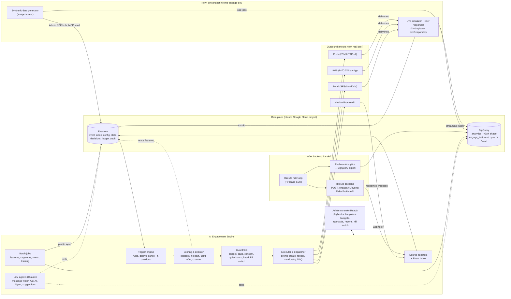
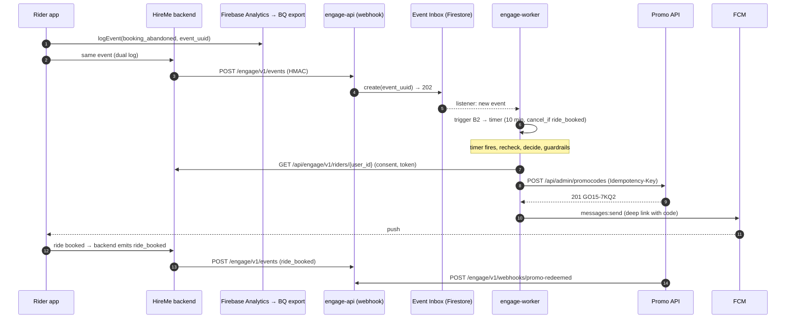
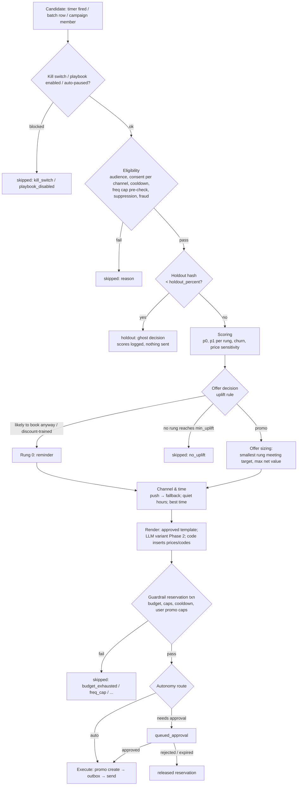
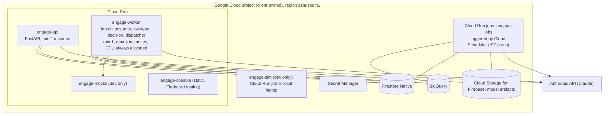

# HireMe AI Engagement Engine: Architecture

| | |
|---|---|
| Status | Proposed, pending client review |
| Date | 2026-11-02 |
| Author | AI (Fable 5.1), lead architect |
| Spec | "HireMe AI Engagement Engine: Specification", @Vinay, Oct 21 2026 |
| Related | [DATA_MODEL.md](DATA_MODEL.md), [API.md](API.md), [DUMMY_DATA_PLAN.md](DUMMY_DATA_PLAN.md), [IMPLEMENTATION_PLAN.md](IMPLEMENTATION_PLAN.md), [AGENTS_AND_SKILLS.md](AGENTS_AND_SKILLS.md), [../decision.md](../decision.md), [../flow.md](../flow.md) |

---

## 1. What changes from the spec, and why

The spec (section 4, section 8) assumes four inbound sources: Firebase MCP, BigQuery export, a HireMe backend webhook (`POST /engage/events`, dual logging) and a HireMe rider DB read API. **Today only the first two exist.** The client has asked us to design the data contract first, prove the engine on synthetic data in Firebase and BigQuery, and then have the HireMe backend emit data in our format.

| Spec assumption (section) | Reality now | Our design | Decision |
|---|---|---|---|
| Real-time events from backend webhook (4, 8.1) | No webhook | All sources converge on one **Event Inbox** (Firestore `engage_events_live`). Now a **simulator** writes to it; later the webhook handler and/or GA4 poller write to it. Trigger engine code does not change. | D-001, D-002 |
| Firebase Analytics history via BigQuery export (8.1) | Not linked for us yet | Synthetic events in a dataset with the **exact GA4 export schema**. Switching to the real export is a config change (`ENGAGE_BQ_GA4_DATASET`). | D-003, D-059 |
| Rider DB read API for consent, phone, email, wallet (8.1) | No API | Firestore `hireme_riders` stub whose documents have the shape of the future Rider Profile API response, behind a `RiderDirectory` interface. | D-013 |
| Promo API exists (8.2) | Not reachable | Contract-faithful **mock Promo API** (HTTP) built from the spec sample. | D-014 |
| FCM / SMS / email / WhatsApp via Grepix (8.3) | Not reachable | Mock channel services with fault injection, behind `ChannelAdapter`. | D-014 |
| Node.js + MySQL + Redis + Python worker (8) | Only Firebase + BigQuery | **Python 3.12** services; **Firestore** for config/state/queues; **BigQuery** for analytics, training and reports. | D-006, D-009 |
| Outcomes come from real riders | No riders | **Closed-loop rider simulator** with a built-in ground-truth response model so uplift vs holdout is measurable. | D-015 |

Everything else in the spec (decision steps 6.1, guardrails 9, autonomy 6.4, learning loop 6.5, reports 10, admin console 7) is kept.

---

## 2. System context



The spec diagram (page 5) maps one to one: **sources** (rider app, Firebase Analytics, Firebase MCP, BigQuery export) → **engine** (trigger engine, scoring & decision, LLM agent, guardrails) → **channels** (Promo API, FCM, SMS & WhatsApp, Email) with the **admin console** underneath. We add the Event Inbox, the executor/dispatcher, batch jobs and (now) the simulator.

---

## 3. Components and responsibilities

| # | Component | Runs as | Responsibility | Key interfaces | Spec |
|---|---|---|---|---|---|
| 1 | **Source adapters** | `engage-worker` (consumers), `engage-api` (webhook) | Turn raw input (simulator writes, webhook POSTs, GA4 BigQuery rows) into canonical envelopes and write them to the Event Inbox with `create()` (dedupe by `event_uuid`). | `EventSource`, `InboxWriter` | 3, 8.1 |
| 2 | **Event Inbox** | Firestore `engage_events_live` | Single ordered-enough buffer of recent events (7-day TTL); the only input the trigger engine reads. | `InboxConsumer` | — |
| 3 | **Trigger engine** | `engage-worker` | Match each event to playbook triggers; create, restart, cancel timers; update real-time counters; schedule batch playbooks. | `TriggerMatcher`, `TimerStore` | 4, 5, 7 |
| 4 | **Timer sweeper** | `engage-worker` | Lease due timers, run the fire-time recheck, hand candidates to the decision pipeline. | `TimerStore.lease_due()` | 4 step 2 |
| 5 | **Decision pipeline** | `engage-worker` | Spec 6.1 steps 1-7: eligibility → holdout → scoring → offer decision → offer sizing → channel/time → message render → guardrail reservation → execute or queue. | `ScoringProvider`, `OfferPolicy`, `ChannelSelector`, `Renderer`, `GuardrailService` | 6.1 |
| 6 | **Guardrail service** | library + Firestore transaction | Budgets, frequency caps, cooldowns, quiet hours, consent, suppression, user promo caps, fraud, kill switch, content check. Enforced in code only (spec 9). | `GuardrailService.reserve()` / `release()` | 9 |
| 7 | **Executor & dispatcher** | `engage-worker` | Create promo via Promo API (idempotent), write messages to the outbox, send through channel adapters, retry with backoff, DLQ, fallback channels. | `PromoAdapter`, `ChannelAdapter` | 6.3, 8.2, 8.3, 9 |
| 8 | **Outcome tracker** | `engage-worker` | Consume outcome events (`notification_opened`, `promo_applied`, `ride_booked`, `ride_completed`, `promo_redeemed`), update messages, promos, ledger, attribution. | — | 4 step 8, 6.5 |
| 9 | **Batch jobs** | `engage-jobs` (Cloud Run jobs + scheduler) | Feature build, segments, base rates, profile sync to Firestore, batch playbooks (E2-E4), promo-expiry release, marts, holdout lift, budget pacing (H5), anomaly detection (H2), digest (H1), model training (Phase 2). | SQL files in `sql/` | 6.2, 6.5, 10 |
| 10 | **LLM agents** | `engage-worker` (writer), `engage-api` (Ask AI), `engage-jobs` (digest, suggestions) | Message writing, Ask AI, insight digest, campaign suggestion, anomaly explanation. Never writes prices or codes. | Anthropic API, tool wrappers over BigQuery/Firestore | 6.1 step 6, 5.8, 9 |
| 11 | **Admin API** | `engage-api` (FastAPI) | Spec 8.4 endpoints plus budgets, settings, kill switch, segments, decisions explain, simulator controls, health. RBAC via Firebase Auth custom claims. | [API.md](API.md) | 7, 8.4 |
| 12 | **Admin console** | `engage-console` (React + TypeScript, Vite) | Screens from spec 7; embeddable into the HireMe admin panel later. | Admin API only | 7 |
| 13 | **Log shipper** | inside each service (async) | Append every operational write to `engage_ops.*` in BigQuery. | BigQuery Storage Write API | 6.5, 10 |
| 14 | **Mocks** | `engage-mocks` (FastAPI) | Promo API, FCM, SMS, email, WhatsApp; delivery callbacks; fault injection. | [API.md §6](API.md#6-outbound-adapter-contracts-and-mock-behaviour) | 8.2, 8.3 |
| 15 | **Simulator** | `engage-sim` (CLI + long-running process) | History generator, live replayer on a virtual clock, rider responder (closed loop), scenario injection. | [DUMMY_DATA_PLAN.md](DUMMY_DATA_PLAN.md) | — |

### 3.1 Source adapter interface (D-002)

```python
class EventSource(Protocol):
    source_id: str                      # "sim_inbox" | "webhook" | "ga4_bq_poll"
    def run(self, writer: "InboxWriter", stop: Event) -> None: ...
    def lag(self) -> timedelta: ...     # exported to /status and alerts

class InboxWriter(Protocol):
    def write(self, env: CanonicalEvent) -> Literal["created", "duplicate", "rejected"]: ...
```

| Adapter | Status | How it works | Latency to inbox |
|---|---|---|---|
| `SimulatorDirect` | **Now (default)** | Simulator process itself calls `InboxWriter.write()` (Admin SDK) and streams the GA4-shaped row to `events_intraday_YYYYMMDD`. | < 1 s |
| `Ga4BigQueryPoll` | Now (optional, exercised in tests); production fallback until the webhook exists | Every 60 s, query `events_intraday_*` (and today's `events_YYYYMMDD`) for `event_timestamp > watermark − 10 min` (overlap for late rows), map GA4 row → envelope, write; watermark in `engage_source_checkpoints/ga4_bq_poll`. Dedupe by `event_uuid`. | 1-3 min after the row lands; real GA4 streaming export adds "within minutes" (spec 3) |
| `WebhookIngest` | Built in Phase 1 behind a flag (contract tests); **production path after handoff** | `POST /engage/v1/events` → validate HMAC + schema → `InboxWriter.write()` → 202. | < 1 s |

The inbox consumer uses a Firestore real-time listener on `engage_events_live` filtered by `processed.state == "new"` plus a 30 s catch-up query (in case a listener drops), and marks documents `done` after the trigger engine commits. Event order per user is not guaranteed by any source, so all logic is order-tolerant (see 5.4).

### 3.2 Why not stream directly from BigQuery or Firestore change feeds

| Option | Verdict |
|---|---|
| Poll BigQuery for every trigger | Rejected as the primary path: GA4 export latency is minutes, and each poll costs a scan. Kept as `Ga4BigQueryPoll` for history and as a fallback. |
| Firestore listener on an inbox collection | **Chosen**: sub-second, cheap at pilot volume, same code serves simulator now and webhook later. |
| Pub/Sub | Better at scale, but adds a GCP service outside the client's "Firebase + BigQuery only" constraint. Interface allows a `PubSubInbox` later (Phase 3). |
| Firebase Realtime Database | No advantage over Firestore here; two databases to secure. |

---

## 4. One event, end to end

### 4.1 Current mode (no webhook): Riya's abandoned booking (spec section 4, playbook B2)

Clock is virtual (D-016); times shown are simulated IST.

| # | Time (IST) | What happens | Where |
|---|---|---|---|
| 1 | 18:10:12 | Simulator (persona `price_sensitive_explorer`, user `u_88213` "Riya") emits `booking_abandoned` (`step=confirm`, `fare_estimate=420`, `drop_area_name="Connaught Place"`). Writes the envelope to `engage_events_live/{event_uuid}` and the GA4-shaped row to `events_intraday_20261021`. | Simulator → Firestore, BigQuery |
| 2 | 18:10:13 | Inbox consumer reads the event; trigger engine finds `B2_abandoned_booking` (`where step != payment`). Any pending B2 timer for Riya is superseded (`on_retrigger: restart`). Creates `engage_timers/tmr_…` with `fire_at = 18:20:12`, `cancel_if = [ride_booked]`. Updates `counters_rt`. | Worker → Firestore |
| 3 | 18:20:12 | Sweeper leases the timer. **Fire-time recheck**: query `engage_events_live` for Riya's `ride_booked` after 18:10:12 → none. | Worker |
| 4 | 18:20:13 | Eligibility: audience (Noida), consent (push yes) from `hireme_riders` (→ Rider API later), cooldown, freq caps, suppression, fraud flag, kill switch. All pass. | Worker |
| 5 | | Holdout: `sha256("hm-2026q4:B2_abandoned_booking:u_88213") mod 10000 = 7312 ≥ 1000` → treatment. (Holdout users get a ghost decision with status `holdout`.) | Worker |
| 6 | | Scoring (Phase 1 `heuristic_v1`): profile from `engage_user_profile/u_88213` (synced nightly from BigQuery): price sensitivity 0.71 (high). Base rate p0 = 0.22; p1 = {0: 0.27, 10: 0.41, 15: 0.48, 20: 0.50}. | Worker |
| 7 | | Offer decision and sizing (D-030): smallest rung where `(p1 − p0) × fare ≥ p1 × E[discount]` and `p1 − p0 ≥ 0.02`, maximising expected net value → **15 %** (cap ₹75; E[discount] = ₹63). Channel: push (token present, opted in). Time: now (18:20 is outside quiet hours). | Worker |
| 8 | | Guardrail reservation (one Firestore transaction): budget ledgers (day, month, city) + user state; liability ₹63×1.25 → ₹75 capped at ₹75; writes cooldown and cap slot. Autonomy effective = min(global 2, city 2, playbook 2) = 2 → auto. | Worker → Firestore |
| 9 | 18:20:14 | Promo adapter → mock Promo API `POST /api/admin/promocodes` (idempotency key = decision id) → `201 {promo_id: 55120, code: "GO15-7KQ2"}`; valid to 18:50. | Worker → mock |
| 10 | | Render: template `tpl_B2_push_en_v1`; Phase 1 deterministic fill, Phase 2 LLM variant + content check; code inserts `{promo_code}`, `{fare}`, `{expiry}`. Message `msg_…_1` queued in outbox. | Worker |
| 11 | 18:20:15 | Dispatcher → mock FCM `messages:send` → `name: projects/…/messages/…`. Delivery callback marks `delivered`. | Worker → mock |
| 12 | 18:24 | Responder draws from ground truth (Riya: open 0.62, convert given 15 % = 0.48) → emits `notification_opened`, `promo_applied`, `ride_booked` (`promo_code=GO15-7KQ2`) back into step 1. | Simulator |
| 13 | 18:31 | Outcome tracker: decision attributed (converted within 24 h). Ride completes in simulation → mock Promo API records redemption → `POST /engage/v1/webhooks/promo-redeemed` → ledger: outstanding −₹75, redeemed +₹63. | Worker |
| 14 | nightly | Log shipper rows → `engage_ops.*`; `engage-jobs` builds `engage_mart.holdout_lift`: B2 Noida treat vs holdout conversion, incremental rides, ROI. | BigQuery |

The B1 version of the same story (spec section 1: Riya checks a fare at 18:10 and gets `RIYA15`-style code at 18:25) is identical except the trigger is `fare_check` with `wait_minutes: 15` and `cancel_if: [booking_started, ride_booked]`. Personal codes use the random format `GO15-7KQ2`; readable codes such as `RIYA15` are not used for personal offers because they are guessable (D-038).

### 4.2 Future mode (after backend handoff)

Only steps 1, 4 and 13 change:

| # | Change |
|---|---|
| 1 | Rider app logs to Firebase Analytics (→ GA4 BigQuery export for history) **and** the app/backend posts the same event (same `event_uuid`) to `POST /engage/v1/events`. The webhook handler writes the envelope into the same Event Inbox. Server-authoritative events (`ride_booked`, `ride_completed`, `payment_failed`, `promo_redeemed`, `consent_changed`, D-042) come from the backend directly. |
| 4 | Consent, contact and wallet come from the Rider Profile API (`RiderDirectory` adapter switched from `FirestoreRiderStub` to `HireMeRiderApi`, 60 s cache, consent never cached longer than 60 s, `consent_changed` events evict the cache). |
| 9, 11 | Real Promo API and Grepix channel APIs instead of mocks (base URL + credentials). |
| 12 | Real riders instead of the responder. |
| 13 | Redemption webhook from the real Promo API. |



---

## 5. Trigger engine

### 5.1 Matching

On each inbox event: load enabled playbooks (cached, invalidated on config change via a Firestore listener on `engage_playbooks`) indexed by `trigger.event` and by every `cancel_if` event. For each matching playbook:

1. Evaluate `where` conditions on params.
2. Apply `max_lateness_minutes`: if `now − event_ts > max_lateness`, record `late_event` in `timers_log` and do not start a timer (D-050). The event still counts for cancellations and features.
3. Compute `timer_id` (deterministic, D-025). `on_retrigger`:
   - `restart`: if a pending timer exists for (playbook, user), mark it `superseded` and create a new one (B2: rider abandons twice; we act on the latest fare).
   - `ignore`: keep the first.
   - `parallel`: one timer per trigger event (C2 per `ride_id`).
4. Write the timer with `create()` (a duplicate event cannot create a second timer).

For each `cancel_if` match: query `engage_timers where user_id == u and status == pending`, filter in code by playbook's `cancel_if` (event name + `match_params` equality, e.g. `ride_id`) and `event_ts > timer.trigger.event_ts`, then transition `pending → cancelled` in a transaction (a `leased` timer is cancelled too; the sweeper re-checks status before deciding).

### 5.2 Timers and windows

| Trigger type | Timer creation | Example |
|---|---|---|
| `event_delay` | `fire_at = event_ts + wait_minutes` (event time, not receipt time, so late arrival shortens the wait) | B2: 10 min; A3: 48 h |
| `relative_time` | One timer per offset: `fire_at = param_time + offset`; skipped if already in the past | C2: `scheduled_time − 60 min`, `− 15 min` |
| `schedule` | Batch job (`engage-jobs batch-playbooks`) runs at `cron_ist`; reads `engage_features.segment_membership_daily` for the segment; emits one candidate per user directly into the decision pipeline (no per-user timer) | E2 at 10:00 IST |
| `window_count` | Real-time counter per (user, group key) in `engage_user_state.counters_rt` with a daily BigQuery reconciliation | B6 (Phase 3) |

**Sweeper**: every 5 s (virtual-clock aware), query `status == pending and fire_at <= now() limit 200`, and lease each with a transaction (`status: leased`, `lease_until = now + 60 s`, `lease_owner = instance`). Expired leases are re-leasable (crash safety). Multiple worker instances are safe.

**Fire-time recheck** (closes the race where the cancelling event arrives late or out of order): before deciding, query the inbox for the user's `cancel_if` events between the trigger `event_ts` and now. If the source is `Ga4BigQueryPoll` (minutes of lag), the recheck also waits until the source watermark passes `fire_at` (bounded by 5 min) before deciding. This is the main reason a webhook is still recommended for B1/B2 in production (D-001).

### 5.3 Conflict resolution between playbooks (D-064)

Playbooks in the same `exclusive_group` (e.g. `intent_recovery` = B1, B2, B3, B4) send at most one message per user per group within the longest group cooldown. The candidate with the higher `priority` wins; if a lower-priority message already went out, the new one is skipped with `superseded_exclusive_group`. Across groups, the global marketing frequency cap arbitrates (first come, first served, with transactional and service classes never blocked by marketing).

### 5.4 Ordering, duplicates, clock skew

| Problem | Handling |
|---|---|
| Duplicate event (dual logging, poller overlap, retries) | Inbox `create(event_uuid)` fails on duplicates; timers and decisions have deterministic ids. |
| Out-of-order events | Cancellation compares `event_ts`, not arrival order; fire-time recheck. |
| Device clock skew | Client events with `event_ts` more than 5 min in the future are clamped to `received_at` and flagged (`params._ts_clamped = true`). |
| Very late events (offline phones) | `max_lateness_minutes` per playbook; still used for features and attribution. |

---

## 6. Decision pipeline (spec 6.1)



Ordering rationale: the cheap, user-level filters run before the holdout split so that treatment and holdout are drawn from the **same eligible population** (otherwise the comparison is biased). Budget and frequency guardrails run after the offer is known (they need the liability) and only for the treatment arm; budget-blocked treatment decisions stay in the treatment arm for intention-to-treat analysis (D-018, D-060).

### 6.1 Steps in detail

| Step | Rule | Phase 1 | Phase 2 |
|---|---|---|---|
| 1 Eligibility | Audience filters; consent for at least one playbook channel (Rider stub now, Rider API later); not in cooldown; daily/weekly cap not already full (pre-check); not suppressed (D2 48 h); not fraud-flagged for promo playbooks (reminders still allowed). | Same | Same |
| 1b Holdout | `bucket = int(sha256(salt + ":" + playbook_id + ":" + user_id)[:8], 16) mod 10000`; holdout if `bucket < holdout_percent × 100`. Stable per user and playbook, independent across playbooks (D-018, D-056). Campaigns use `campaign_id` instead of `playbook_id`. | Same | Same |
| 1c Exploration | Among treatment, `exploration_percent` (default 10 % for promo playbooks) receive a uniformly random rung from the ladder; logged as `arm = exploration` (D-019). | On for B1, B2, E2, E3 | On |
| 2 Scoring | `ScoringProvider.score(user, playbook, context) → {p0, p1[rung], churn, price_sensitivity}` | `heuristic_v1`: p0 from `engage_features.playbook_base_rates` by (playbook, city, price band, recency band); p1 = p0 + configured prior lift per band and rung | `uplift_v1`: LightGBM two-model (T-learner) or X-learner per playbook family, ONNX, in-process; `churn_v1` nightly batch (D-029) |
| 3 Offer decision | Rung r is viable if `(p1[r] − p0) × V ≥ p1[r] × E[discount_r]` and `p1[r] − p0 ≥ min_uplift`, where `V` = average fare value (gross fare estimate, or margin if `value_basis = margin`) and `E[discount_r] = min(r% × fare_estimate, max_discount_inr)` or flat value (D-030). If `p0 ≥ likely_to_book_p0` → rung 0. If `discount_trained` → rung 0. | Same formula, heuristic scores | Same formula, model scores |
| 4 Offer sizing | Among viable rungs pick the smallest rung whose net value `(p1[r] − p0) × V − p1[r] × E[discount_r]` is within 5 % of the best; ties → smaller rung. Rung 0 (reminder) is viable if `p1[0] − p0 ≥ min_uplift`. Nothing viable → skip `no_uplift`. | Same | Same |
| 5 Channel & time | Ordered by playbook `channels`; first channel with consent + reachability (push token not stale, email present, phone not DND for promotional SMS). Fallback on `undeliverable`/`no_token`/`no_consent`; for long-window playbooks optionally `unopened` after N minutes (spec: push not opened in 24 h → SMS/email). Time: `immediate` unless quiet hours; `best_time` (Phase 2) uses `open_hour_hist`. Quiet hours (22:00-08:00 IST, marketing and service): defer to 08:00 + random 0-30 min if within `max_defer_minutes`, else skip `quiet_hours_skip` (D-024). | Same; `best_time` = fixed 10:00/18:00 | `best_time` per user |
| 6 Render | Approved template for (playbook, channel, language). Variables `{first_name}`, `{drop_area}`, `{fare}`, `{promo_code}`, `{expiry}`, `{discount_label}`, `{validity_minutes}`. Prices and codes inserted by code after any LLM step (spec 9). | Deterministic fill | LLM picks/adapts phrasing for push/email/in-app (D-032-D-034); SMS/WhatsApp never (D-033) |
| 7 Guardrails & route | Reservation transaction (DATA_MODEL §4.7); content check; autonomy routing (section 8). | Same | Same |

### 6.2 Phase 1 heuristic priors (initial, tunable per playbook)

| Price sensitivity band | Reminder (rung 0) lift | 10 % | 15 % | 20 % |
|---|---|---|---|---|
| high | +0.04 | +0.15 | +0.22 | +0.25 |
| medium | +0.03 | +0.07 | +0.09 | +0.10 |
| low | +0.03 | +0.03 | +0.04 | +0.04 |

With these priors, high-sensitivity riders get 10-15 %, medium get a reminder or 10 %, low get a reminder only, which matches the spec's intent ("riders likely to book anyway get a reminder with no discount"). The priors are replaced by measured lifts from holdout and exploration data once available (Phase 1 week 4 onwards on synthetic data).

---

## 7. Guardrails (spec 9), all enforced in code

| Guardrail | Rule (default) | Enforcement point | Config |
|---|---|---|---|
| Kill switch | Super admin pauses all AI sends (marketing + service + promo creation); transactional continues unless scope `all` (D-027) | Decision start **and** dispatcher just before each provider call | `engage_settings/global.kill_switch` |
| Budget (hard stop) | Per city × playbook daily and monthly; per city monthly; global monthly. `committed_outstanding + redeemed + new_liability ≤ limit` (D-020) | Reservation transaction | `engage_budgets` |
| Budget pacing (H5) | At 80 % of monthly: alert; throttle playbooks with lowest ROI in the last 14 d (raise `min_uplift` by 0.02 per step) | Hourly job | `alert_threshold_pct`, `throttle_policy` |
| Max discount per ride | ₹100 (global), playbook `max_discount_inr` ≤ global | Playbook validation + offer sizing | settings / playbook |
| Max promo per user per month | ₹300 committed and 4 codes | Reservation transaction | `user_promo_caps` |
| Discount ladder only | Offers only from the approved ladder | Offer sizing + validation of approved version | playbook |
| Frequency cap | Marketing: 1 per IST day, 3 per rolling 7 days, across channels. Service: 2 per day. Transactional exempt (D-022, D-023) | Pre-check + reservation | `freq_caps` |
| Quiet hours | 22:00-08:00 local (IST) for marketing and service; transactional exempt | Channel & time step + dispatcher re-check | `quiet_hours` |
| Cooldown | Per playbook (B2: 24 h) | Eligibility + reservation | playbook |
| Bad experience suppression | 48 h no marketing after rating ≤ 2 or support ticket (D2) | Outcome tracker sets `suppress_marketing_until` | D2 playbook |
| Consent | Per channel opt-in; unsubscribe honoured instantly; consent checked at decision **and** at send (D-053) | Eligibility + dispatcher | Rider stub / API |
| DND / DLT | Promotional SMS only to non-DND numbers, only DLT-registered templates with the registered header | Channel selection + SMS adapter | template `dlt` |
| Discount-trained | No promo (reminder only) if `discount_trained_flag` (D-046) | Offer decision | playbook flag |
| Fraud | No promo to `fraud_flagged`; welcome offer blocked for repeat `device_id_hash` | Eligibility | features |
| Content check | Rendered text: no digits or currency outside inserted variables; banned phrases; length per channel; language matches; placeholders all resolved (D-034) | Render step | `contracts/content_policy.yaml` |
| Holdout integrity | Holdout users never receive the playbook's message (asserted in dispatcher) | Dispatcher | — |

Every guardrail result is appended to `decision.guardrails[]`, so the console "Why?" view and the audit log explain every skip.

---

## 8. Autonomy levels and approvals (spec 6.4, D-028)

`autonomy_effective = min(settings.global.autonomy_max, settings.city_{id}.autonomy_max, playbook.autonomy)`.

| Level | Reminders (rung 0) | Promos within approved ladder and budget | New playbooks / campaigns by AI | Typical phase |
|---|---|---|---|---|
| 0 Suggest only | Queued | Queued | Draft only | Phase 1 weeks 1-2 of pilot (shadow) |
| 1 Auto for reminders (default) | Auto | Queued | Draft only | Phase 1 pilot |
| 2 Auto within budget | Auto | Auto | Draft only | Phase 2 after "Uplift beats holdout" |
| 3 Full auto with alerts | Auto | Auto | AI-created playbooks auto-enabled with a capped trial budget; daily digest | Phase 3, mature operators |

**Approval granularity** (spec says "admin approves each"; per-rider approval cannot work for a 10-minute trigger):

| Approval kind | What is approved | Effect | Expiry |
|---|---|---|---|
| `playbook_version` | Trigger, audience, ladder, templates, budget of one version | Pre-approves every rule-conformant send of that version at levels 1-2 | none |
| `template` | Template text (and LLM variant set) | Usable by playbooks | none |
| `cohort_batch` | One batch run of a scheduled playbook (e.g. E3 today: 412 riders, predicted cost ₹9,800, predicted incremental rides 37) | Releases the batch | 24 h |
| `campaign` | Manual broadcast or AI-suggested campaign (H3) | Schedules it | per campaign |
| `realtime_decision` | Single real-time decision at levels 0 (all) and 1 (promos) | Sends if approved before `min(promo validity, 30 min)` | short; otherwise `approval_expired` |

At level 0 for real-time playbooks, almost all items expire: the engine effectively runs in **shadow mode**, which is what the spec's Phase 1 "suggest only" needs (the admin sees exactly what would have been sent, with predicted cost and uplift).

---

## 9. Learning loop, attribution and holdout (spec 6.5, 10)

| Element | Design | Decision |
|---|---|---|
| Unit of randomisation | User × playbook (deterministic hash with salt; salt rotates only with an explicit "new experiment" action) | D-018 |
| Holdout share | 10 % per playbook (configurable 0-50 %); optional global holdout (default 0 %) | D-018, D-056 |
| Ghost decisions | Holdout users get a full decision record with scores and the offer they would have received, status `holdout` | D-018 |
| Attribution window | From decision time (same anchor for both arms): 24 h intent playbooks, 7 d win-back, per-playbook override | D-031 |
| Conversion | `attribution.conversion_event` (default `ride_booked`) by the same user in the window; fare value from `ride_completed.gross_fare` | D-031 |
| Credit for "converted" counts | Last-touch: the most recent sent decision in-window gets credit in per-message reports | D-031 |
| Incrementality | Intention-to-treat per playbook: treat arm (treatment + exploration, including budget-blocked) vs holdout. Lift = conv_treat − conv_hold; 95 % CI (Newcombe hybrid score); incremental rides = lift × n_treat; ROI = (incremental fare value − promo cost) / promo cost | D-060 |
| Minimum sample | Report "insufficient data" until each arm has ≥ 400 decisions; gate decisions need the CI lower bound > 0 | D-060 |
| Auto-pause | Playbook with ROI CI upper bound < 0 for 14 consecutive days is auto-paused (spec 6.5), alert sent | D-060 |
| Training data | `engage_ml.uplift_training_examples` from holdout + treatment + exploration decisions with outcomes; features as of the day before the decision (no leakage) | D-019, D-029 |
| Retraining | Weekly (Sunday 02:00 IST); candidate → shadow (scores logged, not used) → active after Qini/AUUC and calibration beat the incumbent on a time-split holdout | D-029, D-045 |
| Synthetic validation | On synthetic data the true per-user uplift is known (`engage_sim`), so we also check that the model's ranking matches the truth; the engine never reads `engage_sim` | D-012, D-015 |

Sample size reasoning (B2-like): baseline 9 % (spec 10 example), 10 % holdout, detecting a 3-point lift at 80 % power, α = 0.05 two-sided needs ≈ 800 holdout and ≈ 7,200 treatment decisions, about 8,000 eligible triggers. The spec example (4,820 eligible per month in Noida) means about 7 weeks of real pilot for a 3-point effect, or 3-4 weeks for the 7-point effect in the spec example. The synthetic data is sized so this is reached within one 30-day simulated run (DUMMY_DATA_PLAN §6).

---

## 10. Reliability

| Concern | Design | Decision |
|---|---|---|
| Idempotent processing | `event_uuid` → inbox doc id; `timer_id`, `decision_id`, `message_id`, `promo_ref` all deterministic hashes; every provider call carries an idempotency key (`decision_id` for promo, `message_id` for channels) | D-025 |
| One decision = one message | `message_id = msg_<decision>_<channel_ordinal>`; fallbacks get ordinal 2, 3 and are only created when the previous ordinal is terminal-failed or (if configured) unopened | D-025, D-049 |
| Retries | Exponential backoff with full jitter: 5 s, 20 s, 80 s, 5 min, 20 min (max 5 attempts) for retryable errors (429, 5xx, timeouts). Non-retryable (invalid token, DLT mismatch, 4xx) → `undeliverable` → fallback channel | D-026 |
| Send-time revalidation | Before each provider call: kill switch, consent, quiet hours, promo still valid (≥ 5 min left), decision not cancelled | D-026 |
| Dead letter queue | After the last attempt: `engage_dlq/{message_id}` with full context; reservation released; console DLQ view with replay | D-026 |
| Promo API failures | Retry 3× with the same idempotency key; on persistent failure, downgrade to reminder if the playbook allows (`promo_api_error` reason) or skip | D-026 |
| Worker crashes | Leases on timers and outbox messages expire after 60 s and are retried; Firestore transactions guarantee no double reservation | D-008 |
| Kill switch | One API call / console click; cached ≤ 5 s; checked at decision start and before every provider call | D-027 |
| Backpressure | Dispatcher rate limits per channel (FCM 500/s, SMS 50/s configurable); sweeper batch size 200 | — |
| Source lag | `/status` exposes inbox consumer lag and poller watermark; H2-style alert if lag > 5 min | — |
| Observability | Structured JSON logs (Cloud Logging), OpenTelemetry traces with `decision_id` as attribute, metrics: decisions/min by status, guardrail skips by reason, send latency, DLQ size, LLM latency and fallback rate | — |

---

## 11. Security and compliance

| Area | Design | Decision |
|---|---|---|
| Data location | All data in the client's own Google Cloud/Firebase project (spec 9), region `asia-south1` (Mumbai) | D-051 |
| Environments | `hireme-engage-dev` (synthetic only) and later `hireme-engage-prod` (client project). Synthetic and real data never share a project. | D-012 |
| Admin auth | Firebase Authentication for console users; custom claims `{role: super\|marketing\|city_admin, city_ids: [...]}`; API verifies ID tokens; every mutation audited | D-039, D-040 |
| Service auth | Webhooks: HMAC-SHA256 signature with timestamp (5 min tolerance) and key rotation; service-to-service: Google-signed OIDC tokens on Cloud Run | D-040, D-041 |
| Least privilege | Separate service accounts: `engage-worker` (Firestore rw, BigQuery write `engage_ops`, read features), `engage-jobs` (BigQuery rw), `engage-api` (Firestore rw, BigQuery read `engage_views` for Ask AI), `sim` (write raw data, read/write `engage_sim`). Engine accounts cannot read `engage_sim`. | D-012 |
| Secrets | Secret Manager in deployed environments; `.env` (git-ignored) locally; no secrets in Firestore | D-052 |
| PII minimisation | LLM receives pseudonymous `user_id`, first name, language, area names, offer label; never phone, email, payment data or exact addresses. Ask AI only queries `engage_views` (aggregated, k ≥ 20). Logs mask phone/email. | D-035 |
| DPDP Act 2023 (India) | Consent per purpose and channel, recorded with timestamp and source; withdrawal honoured instantly (`consent_changed`); data principal requests (access, correction, erasure) via backend → engine erasure job (deletes `engage_user_state`, `engage_user_profile`, pseudonymises decisions); retention limits per collection (DATA_MODEL §4.1) | D-053 |
| TRAI DLT (SMS) | Registered PE ID, header (sender ID) and content templates; template id sent with every SMS; promotional SMS only to non-DND numbers and 10:00-21:00 (TRAI promotional window is within our quiet hours); transactional/service categories mapped from `message_class` | D-023, D-033 |
| WhatsApp | Business-initiated messages only with pre-approved templates; opt-in required | D-033 |
| GDPR / TCPA / CAN-SPAM (white label, Phase 3) | Per-market policy pack: consent model, quiet hours by local time zone, unsubscribe in every email (CAN-SPAM), SMS STOP handling (TCPA), lawful basis records (GDPR) | — |
| Content safety | LLM output passes the content check; prices and codes inserted by code; failure → deterministic template | D-034 |
| Fraud | User-locked single-use codes; device and payment multi-account detection; code-only-booker flag; referral rewards only after a paid first ride (A6, Phase 3) | D-046 |

---

## 12. Deployment topology



Locally, every service runs as a Python process from the repo's `.venv`; unit and scenario tests use the Firestore emulator; BigQuery SQL tests use a dedicated `engage_test_*` dataset in the dev project with fixture data.

Scheduled jobs (IST):

| Job | Schedule | Purpose |
|---|---|---|
| `features-daily` | 01:30 | `user_features_daily`, segments, base rates, fraud flags |
| `profile-sync` | 03:00 and hourly delta | BigQuery → `engage_user_profile` |
| `batch-playbooks` | 10:00 (E2, E3), Mon 10:00 (E4) | Scheduled playbooks |
| `promo-expiry` | every 5 min | Release liabilities of expired codes |
| `marts` | 04:00 and hourly for today | `engage_mart.*` |
| `budget-pacing` (H5) | hourly | Alerts and throttling |
| `anomaly` (H2) | every 15 min | Detect and explain anomalies |
| `digest` (H1) | 08:45 (delivered 09:00) | Daily insight digest |
| `train-models` | Sun 02:00 (Phase 2) | Retrain and evaluate |
| `ops-reconcile` | 02:30 | Firestore ↔ `engage_ops` row counts, ledger invariants |

---

## 13. Tech stack

| Layer | Choice | Why | Decision |
|---|---|---|---|
| Language (services, jobs, sim, mocks) | Python 3.12 | One language for data generation, SQL orchestration, ML scoring and API; existing `.venv`; mature Firestore/BigQuery/Anthropic SDKs; HTTP contracts make the language irrelevant to the backend handoff | D-009 |
| API framework | FastAPI + Pydantic v2 | OpenAPI generated from the same models as the contracts | D-009 |
| Console | React 18 + TypeScript + Vite, TanStack Query | Spec says React module in the existing admin panel | D-039 |
| Operational store | Firestore (Native) | Only database available now; transactions, TTL, listeners; replaces MySQL + Redis for v1 | D-006 |
| Timers / queues | Firestore collections with leases | No Redis / Cloud Tasks yet; behind `TimerStore` / `Outbox` interfaces | D-008 |
| Analytics / ML data | BigQuery | Spec; GA4 export lives there | D-003, D-007 |
| Transformations | Versioned SQL files run by `engage-jobs` | Simple; dbt later if needed | D-044 |
| ML | LightGBM → ONNX (onnxruntime in-process) in Phase 2; scikit-learn for calibration | Spec suggests gradient boosting; ONNX keeps scoring < 5 ms | D-029, D-045 |
| LLM | Anthropic API: `claude-haiku-5-5` (message writer, anomaly explainer), `claude-sonnet-5-5` (Ask AI, digest), `claude-opus-5-5` (campaign suggestions, playbook tuner) | Cost/latency per task | D-032 |
| Hosting | Cloud Run + Cloud Scheduler + Firebase Hosting | Serverless in client's project | D-051 |
| Testing | pytest, Firestore emulator, JSON Schema validation, simulator-driven scenario tests, statistical acceptance tests | — | — |

---

## 14. Repository layout (target)

```
hire-me-promo/
├── README.md  CLAUDE.md  decision.md  flow.md
├── .mcp.json                     # firebase + bigquery MCP servers (AGENTS_AND_SKILLS.md)
├── .claude/
│   ├── settings.json             # permissions
│   ├── agents/*.md               # Claude Code subagents
│   └── skills/<name>/SKILL.md    # Claude Code skills
├── docs/                         # this plan; docs/reference = spec
├── contracts/                    # THE deliverable for the backend team
│   ├── events/v1/                # envelope.schema.json + one schema per event
│   ├── bigquery/                 # ga4_events_schema.json, DDL for all datasets
│   ├── firestore/                # firestore.indexes.json, firestore.rules, ttl.yaml
│   ├── openapi/                  # engage-admin.v1.yaml, engage-ingest.v1.yaml, rider-api.v1.yaml, promo-api.v1.yaml
│   ├── playbook.schema.json
│   └── content_policy.yaml
├── engage/                       # Python package (engine)
│   ├── core/                     # config, clock, ids, models (pydantic), logging
│   ├── sources/                  # base.py, inbox.py, sim_direct.py, ga4_bq_poll.py, webhook.py
│   ├── triggers/                 # matcher.py, timers.py, sweeper.py, batch.py
│   ├── decision/                 # pipeline.py, eligibility.py, holdout.py, offer.py, channel.py
│   │   └── scoring/              # base.py, heuristic_v1.py, uplift_v1.py
│   ├── guardrails/               # reservation.py, budget.py, caps.py, quiet_hours.py, consent.py, fraud.py, content.py, killswitch.py
│   ├── messaging/                # templates.py, render.py, llm_writer.py
│   ├── adapters/                 # promo/, channels/{push,sms,email,whatsapp}/, riders/ (stub + api)
│   ├── dispatch/                 # outbox.py, retry.py, dlq.py
│   ├── outcomes/                 # tracker.py, attribution.py
│   ├── agents/                   # ask_ai.py, digest.py, campaign_suggest.py, anomaly_explain.py, tools/
│   ├── api/                      # FastAPI app, routers, auth
│   ├── jobs/                     # job entrypoints (features, marts, pacing, training...)
│   └── store/                    # firestore repos, bigquery log shipper
├── sql/                          # features/, marts/, reports/, ml/, checks/
├── playbooks/                    # A2_welcome_offer.json ... (validated in CI)
├── templates/                    # *.yaml message templates (en, hi)
├── sim/                          # generator/, personas.yaml, scenarios/, replayer.py, responder.py, loaders/, validate/
├── mocks/                        # FastAPI app: promo, fcm, sms, email, whatsapp
├── console/                      # React app
└── tests/                        # unit/, contract/, scenario/, sql/, stats/
```

---

## 15. Cross-reference: spec section → this design

| Spec | Where |
|---|---|
| 1 Overview, Riya example | §4.1; DUMMY_DATA_PLAN scenario `riya_b1`, `riya_b2` |
| 2 Scope and actors | §3, §8; API.md roles |
| 3 Event taxonomy, user properties, data freshness | DATA_MODEL §2; §3.1; D-001 |
| 4 Architecture, one event end to end | §2, §4 |
| 5 Use-case catalogue (45 playbooks) | DATA_MODEL §5; IMPLEMENTATION_PLAN §4 |
| 6.1 Decision steps | §6 |
| 6.2 Segments | DATA_MODEL §3.4 |
| 6.3 Promo generation | §6, API.md §6.1, D-038 |
| 6.4 Autonomy | §8 |
| 6.5 Learning loop | §9 |
| 7 Admin console | API.md; IMPLEMENTATION_PLAN M1.5 |
| 8 API contracts and data model | API.md; DATA_MODEL |
| 9 Guardrails, compliance, fraud, reliability | §7, §10, §11 |
| 10 Reporting | DATA_MODEL §3.7; API.md reports |
| 11 Rollout | IMPLEMENTATION_PLAN |
