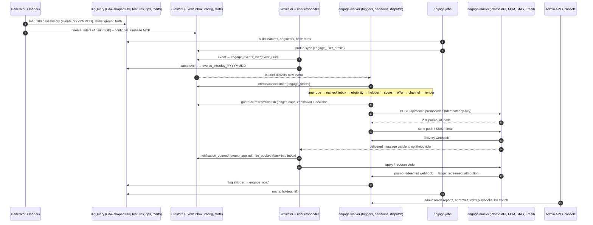

# Project Flow

> **Keep this file current.** It describes how the project works *right now*. Whenever the flow changes (a data source, a step, an adapter, a job, a mock, a switch to a real service), update the "Current flow" section and its diagram in the same change, and record the design decision in [decision.md](decision.md). Planned behaviour belongs only in "Future flow".

**Last updated:** 2026-11-04 — M0.1: data contract v1.0.0-rc1 written to `contracts/` with generator and validator (step 1). No runtime yet: steps 2-17 describe what the Phase 0/1 build will implement.

**Current stage:** Phase 0, M0.1 (data contract) done as a release candidate; M0.2 (dev project) next. Constraints: data sources are only the Firebase project (Firestore, via the Firebase MCP server for agents and tooling, Admin SDK for services) and BigQuery. No HireMe backend webhook, no Rider DB API, no real Promo API or channels: all are simulated or mocked.

---

## Current flow (synthetic data → Firebase/BigQuery → engine → mocks → reporting)

### A. One-time setup and history load

1. **Contract and config** (exists): `contracts/events/v1/catalog.yaml` is the single source for events; `.venv/bin/python -m engage.tools.gen_contract` generates the envelope schema, GA4 mapping, examples and EVENTS.md; `.venv/bin/python -m engage.tools.validate_contract --all` checks the whole contract (schemas, OpenAPI for ingest, Rider API and Promo API, playbook and template schemas, BigQuery DDL, Firestore indexes and rules). See [contracts/README.md](contracts/README.md).
2. **Create storage** in the dev project `hireme-engage-dev` (asia-south1): BigQuery datasets `analytics_999999999` (GA4 export shape), `hireme_ref`, `hireme_backend_stub`, `engage_features`, `engage_ops`, `engage_ml`, `engage_mart`, `engage_views`, `engage_sim`; Firestore collections with indexes and TTL.
3. **Generate history**: `sim/generator` creates 20,000 synthetic riders (12 personas, Noida/Delhi/Gurgaon) and 180 days of events (2026-05-05 to 2026-10-31) as canonical envelopes, converted to GA4 rows.
4. **Load**:
   - BigQuery load jobs → `analytics_999999999.events_YYYYMMDD`, `hireme_ref.*`, `hireme_backend_stub.*`, ground truth → `engage_sim.*`.
   - Firestore Admin SDK bulk writes → `hireme_riders` (Rider DB stand-in: contact, consent, push tokens, wallet).
   - Firebase MCP server (skill `seed-firestore`) → engine config: `engage_settings`, `engage_playbooks` (12 MVP playbooks), `engage_templates`, `engage_budgets`, `engage_segments`.
   - Validation checks `sql/checks` V1-V14 via the BigQuery MCP server.
5. **Build features**: `engage-jobs features-daily` → `engage_features.user_features_daily`, segments, base rates, fraud flags; `profile-sync` → Firestore `engage_user_profile`.

### B. Live run (simulator on a virtual clock)

6. **Simulator emits events** from 2026-11-01 IST at N× speed: each event is written to Firestore **Event Inbox** `engage_events_live/{event_uuid}` and streamed to BigQuery `events_intraday_YYYYMMDD` (copied to `events_YYYYMMDD` at virtual midnight).
7. **Inbox consumer** (`engage-worker`) receives new inbox documents via a Firestore listener, updates real-time counters (`engage_user_state`) and passes events to the **trigger engine**.
8. **Trigger engine** matches playbooks: creates timers in `engage_timers` (e.g. B2: `booking_abandoned` + 10 min), restarts or supersedes duplicates, and cancels pending timers when a `cancel_if` event arrives (e.g. `ride_booked`). Scheduled playbooks (E2/E3/E4) are started by the `batch-playbooks` job at 10:00 IST from BigQuery segments.
9. **Timer sweeper** leases due timers and re-checks the inbox for cancelling events (fire-time recheck).
10. **Decision pipeline** for each candidate: kill switch / playbook state → eligibility (audience, consent from `hireme_riders`, cooldown, caps, suppression, fraud) → **holdout hash** (holdout users get a ghost decision, nothing is sent) → scoring (`heuristic_v1` from `engage_user_profile` + base rates) → uplift offer rule and ladder sizing → channel and time (push first, quiet hours 22:00-08:00 IST) → template render (deterministic in Phase 1) → **guardrail reservation** (one Firestore transaction: budget ledgers, caps, cooldown, user promo caps) → autonomy routing (auto, or `engage_approvals` queue).
11. **Execute**: create the promo code on the **mock Promo API** (idempotent by decision id) → write the message to the outbox (`engage_messages`) → dispatcher sends to the **mock FCM / SMS / email** services (retries, fallback channel, DLQ) → mocks record deliveries in `mock_deliveries` and call the engine's delivery webhook.
12. **Rider responder** (simulator) reads delivered messages and, using the ground-truth response model, emits outcome events (`notification_opened`, `promo_applied`, `ride_booked`, `ride_completed`, opt-outs) back into step 6, and applies/redeems codes on the mock Promo API.
13. **Mock Promo API** calls `POST /engage/v1/webhooks/promo-redeemed` → outcome tracker marks the promo redeemed, moves ledger amounts from committed to redeemed, and attributes the conversion to the decision. The `promo-expiry` job releases liabilities of expired codes.
14. **Log shipper** appends every decision, message, promo, ledger entry and audit record to BigQuery `engage_ops.*`.

### C. Reporting and control

15. **Marts** (`engage-jobs marts`): `engage_mart.*` including `holdout_lift` (treated vs holdout conversion, incremental rides, promo cost, ROI). Validation V12 compares measured lift with the hidden ground truth in `engage_sim`.
16. **Admin API + console**: playbooks, templates, budgets, approvals, reports, decision explorer, audit log, kill switch, simulator controls (dev only).
17. **Guardrail jobs**: budget pacing (H5, hourly), reconciliation (nightly).

---

## Future flow (after backend handoff)

*Not active. Each switch is a configuration flag, flipped one at a time (IMPLEMENTATION_PLAN §5).*

- **Events**: the real rider app logs to Firebase Analytics (→ real GA4 BigQuery export, `ENGAGE_BQ_GA4_DATASET=analytics_<real_id>`) and the HireMe backend posts the same events (same `event_uuid`) plus server-authoritative events to `POST /engage/v1/events`; the webhook handler writes them into the same Event Inbox. `Ga4BigQueryPoll` remains as a fallback source. The simulator is not used in production.
- **Rider data and consent**: `RiderDirectory` switches from the `hireme_riders` stub to the HireMe Rider Profile API; unsubscribe writes back to the backend; `consent_changed` events evict the cache.
- **Promo**: real HireMe Promo API (create with idempotency, usage, deactivate, redemption webhook).
- **Channels**: real FCM / Grepix SMS (DLT-registered templates) / email, later WhatsApp.
- **Outcomes**: real riders; no rider responder; no ground truth (lift measured only against holdout).
- **Clock**: real (`ENGAGE_CLOCK=real`); production project instead of `hireme-engage-dev`.
- **Phase 2 additions** (planned in both modes): uplift/churn model scoring instead of `heuristic_v1`; LLM message writer for push/email; Ask AI, daily digest, anomaly alerts, campaign suggestions.
