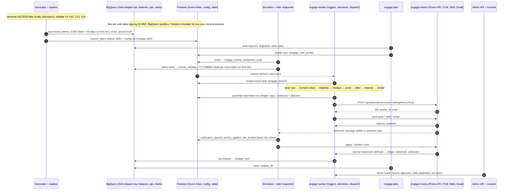

# Project Flow

> **Keep this file current.** It describes how the project works *right now*. Whenever the flow changes (a data source, a step, an adapter, a job, a mock, a switch to a real service), update the "Current flow" section and its diagram in the same change, and record the design decision in [decision.md](decision.md). Planned behaviour belongs only in "Future flow".

**Last updated:** 2026-11-09 — Client accepted the plan; the generator takes `--history-end` (D-084); the Firestore emulator runs from `.venv` via `scripts/firebase.sh` (D-085); after handoff server events also go to GA4 (D-086). Earlier: the dev project starts on the free tier (Firebase Spark + BigQuery sandbox) at `demo` scale (3,000 riders, 45 days, D-083), with a local runtime and the Firestore emulator for live runs; Blaze comes at client signing (D-082). Before that: M0.3 started, the generator and its local validator write files (step 3, D-078). Steps 1 and 3 exist; steps 2 and 4-17 describe what the Phase 0/1 build will implement.

**Current stage:** Phase 0. M0.1 (data contract) done as a release candidate; M0.3 generator built and validated locally at `tiny` and `small` scale; M0.2 (dev project) is no longer blocked: we create it on the free tier (D-082); loading (step 4) is not built yet. Constraints: data sources are only the Firebase project (Firestore, via the Firebase MCP server for agents and tooling, Admin SDK for services) and BigQuery. No HireMe backend webhook, no Rider DB API, no real Promo API or channels: all are simulated or mocked.

---

## Current flow (synthetic data → Firebase/BigQuery → engine → mocks → reporting)

### A. One-time setup and history load

1. **Contract and config** (exists): `contracts/events/v1/catalog.yaml` is the single source for events; `.venv/bin/python -m engage.tools.gen_contract` generates the envelope schema, GA4 mapping, examples and EVENTS.md; `.venv/bin/python -m engage.tools.validate_contract --all` checks the whole contract (schemas, OpenAPI for ingest, Rider API and Promo API, playbook and template schemas, BigQuery DDL, Firestore indexes and rules). See [contracts/README.md](contracts/README.md).
2. **Create storage** in the dev project `hireme-engage-dev` (asia-south1; free tier until client signing: Firebase Spark + BigQuery sandbox, D-082): BigQuery datasets `analytics_999999999` (GA4 export shape), `hireme_ref`, `hireme_backend_stub`, `engage_features`, `engage_ops`, `engage_ml`, `engage_mart`, `engage_views`, `engage_sim`; Firestore collections with indexes and TTL. The same collections run in the local Firestore emulator for live runs and tests (exists: `scripts/firebase.sh emulators:start --only firestore --project demo-hireme-engage-dev`, rules and indexes from `contracts/firestore/`, D-085).
3. **Generate history** (exists, local, D-078): `.venv/bin/python -m sim.generator --scale <tiny|small|medium|large> --seed <n>` reads `sim/personas.yaml`, `sim/geo.yaml`, `sim/calendar.yaml` and simulates riders day by day (12 personas, Noida/Delhi/Gurgaon; `demo` = 3,000 riders × 45 days is the free-tier default, D-083; `medium` = 20,000 riders × 180 days, 2026-05-05 to 2026-10-31). Each event is built as a canonical envelope and converted to a GA4 row with `engage/contract/ga4.py`. Output goes to `data/gen/<scale>_s<seed>/` as NDJSON: envelopes and GA4 rows per IST day, `hireme_ref`, `hireme_backend_stub`, `engage_sim` ground truth, `hireme_riders` documents, open scheduled rides, and `manifest.json`. Same seed gives byte-identical files. `--history-end YYYY-MM-DD|yesterday` moves the window (free-tier loads use `--scale demo --history-end yesterday`, D-084). `.venv/bin/python -m sim.validate <dir>` runs V1-V10, V13, V14 on the files.
4. **Load** (planned, M0.3 loaders). On the free tier only `demo` is loaded (3,000 riders, 45 days, inside the sandbox's 60-day window); `small`/`medium` are checked locally (D-082, D-083):
   - BigQuery load jobs → `analytics_999999999.events_YYYYMMDD`, `hireme_ref.*`, `hireme_backend_stub.*`, ground truth → `engage_sim.*`.
   - Firestore Admin SDK bulk writes → `hireme_riders` (Rider DB stand-in: contact, consent, push tokens, wallet).
   - Firebase MCP server (skill `seed-firestore`) → engine config: `engage_settings`, `engage_playbooks` (12 MVP playbooks), `engage_templates`, `engage_budgets`, `engage_segments`.
   - Validation checks `sql/checks` V1-V14 via the BigQuery MCP server.
5. **Build features**: `engage-jobs features-daily` → `engage_features.user_features_daily`, segments, base rates, fraud flags; `profile-sync` → Firestore `engage_user_profile`.

### B. Live run (simulator on a virtual clock)

6. **Simulator emits events** from 2026-11-01 IST at N× speed (60 virtual days for `demo`, D-083): each event is written to Firestore **Event Inbox** `engage_events_live/{event_uuid}` (the Firestore emulator on the free tier) and sent to BigQuery `events_intraday_YYYYMMDD` (copied to `events_YYYYMMDD` at virtual midnight). On the free tier the BigQuery side uses load-job micro-batches (for example every virtual hour) because the sandbox has no streaming (D-082).
7. **Inbox consumer** (`engage-worker`; engine, jobs and mocks run as local Python processes on the free tier, Cloud Run after the Blaze switch, D-082) receives new inbox documents via a Firestore listener, updates real-time counters (`engage_user_state`) and passes events to the **trigger engine**.
8. **Trigger engine** matches playbooks: creates timers in `engage_timers` (e.g. B2: `booking_abandoned` + 10 min), restarts or supersedes duplicates, and cancels pending timers when a `cancel_if` event arrives (e.g. `ride_booked`). Scheduled playbooks (E2/E3/E4) are started by the `batch-playbooks` job at 10:00 IST from BigQuery segments.
9. **Timer sweeper** leases due timers and re-checks the inbox for cancelling events (fire-time recheck).
10. **Decision pipeline** for each candidate: kill switch / playbook state → eligibility (audience, consent from `hireme_riders`, cooldown, caps, suppression, fraud) → **holdout hash** (holdout users get a ghost decision, nothing is sent) → scoring (`heuristic_v1` from `engage_user_profile` + base rates) → uplift offer rule and ladder sizing → channel and time (push first, quiet hours 22:00-08:00 IST) → template render (deterministic in Phase 1) → **guardrail reservation** (one Firestore transaction: budget ledgers, caps, cooldown, user promo caps) → autonomy routing (auto, or `engage_approvals` queue).
11. **Execute**: create the promo code on the **mock Promo API** (idempotent by decision id) → write the message to the outbox (`engage_messages`) → dispatcher sends to the **mock FCM / SMS / email** services (retries, fallback channel, DLQ) → mocks record deliveries in `mock_deliveries` and call the engine's delivery webhook.
12. **Rider responder** (simulator) reads delivered messages and, using the ground-truth response model, emits outcome events (`notification_opened`, `promo_applied`, `ride_booked`, `ride_completed`, opt-outs) back into step 6, and applies/redeems codes on the mock Promo API.
13. **Mock Promo API** calls `POST /engage/v1/webhooks/promo-redeemed` → outcome tracker marks the promo redeemed, moves ledger amounts from committed to redeemed, and attributes the conversion to the decision. The `promo-expiry` job releases liabilities of expired codes.
14. **Log shipper** appends every decision, message, promo, ledger entry and audit record to BigQuery `engage_ops.*` (load-job batches on the free tier; derived tables are rebuilt with `CREATE OR REPLACE TABLE` because the sandbox has no `MERGE`, D-082).

### C. Reporting and control

15. **Marts** (`engage-jobs marts`): `engage_mart.*` including `holdout_lift` (treated vs holdout conversion, incremental rides, promo cost, ROI). Validation V12 compares measured lift with the hidden ground truth in `engage_sim`.
16. **Admin API + console**: playbooks, templates, budgets, approvals, reports, decision explorer, audit log, kill switch, simulator controls (dev only).
17. **Guardrail jobs**: budget pacing (H5, hourly), reconciliation (nightly).

---

## Future flow (after backend handoff)

*Not active. Each switch is a configuration flag, flipped one at a time (IMPLEMENTATION_PLAN §5).*

- **Events**: the real rider app logs to Firebase Analytics (→ real GA4 BigQuery export, `ENGAGE_BQ_GA4_DATASET=analytics_<real_id>`) and the HireMe backend posts the same events (same `event_uuid`) plus server-authoritative events to `POST /engage/v1/events`; the backend also sends its server events to GA4 via the Measurement Protocol, so the GA4 export holds every event (D-086; deduped by `event_uuid`); the webhook handler writes them into the same Event Inbox. `Ga4BigQueryPoll` remains as a fallback source. The simulator is not used in production.
- **Rider data and consent**: `RiderDirectory` switches from the `hireme_riders` stub to the HireMe Rider Profile API; unsubscribe writes back to the backend; `consent_changed` events evict the cache.
- **Promo**: real HireMe Promo API (create with idempotency, usage, deactivate, redemption webhook).
- **Channels**: real FCM / Grepix SMS (DLT-registered templates) / email, later WhatsApp.
- **Outcomes**: real riders; no rider responder; no ground truth (lift measured only against holdout).
- **Blaze switch** (at client signing, before `medium` gate evidence and the pilot, D-082/OQ-04): client-paid project; `medium` loaded; Cloud Run services and jobs with Cloud Scheduler; streaming to BigQuery; `MERGE`-based jobs; Secret Manager.
- **Clock**: real (`ENGAGE_CLOCK=real`); production project instead of `hireme-engage-dev`.
- **Phase 2 additions** (planned in both modes): uplift/churn model scoring instead of `heuristic_v1`; LLM message writer for push/email; Ask AI, daily digest, anomaly alerts, campaign suggestions.
